# LitScope-Lite

## Evidence-Based Verification of Scientific Claims Using NLP

LitScope-Lite is a research-oriented natural language processing project that investigates scientific claim verification through evidence retrieval, sentence-level evidence selection, and natural language inference.

The system retrieves relevant scientific abstracts, extracts potential evidence, and predicts whether each source supports, contradicts, or provides insufficient information about a scientific claim. A confidence-based two-tier classification architecture is investigated to balance verification performance and inference cost.

The project is a functional research prototype rather than an authoritative scientific fact-checking system.

## Team Members

| Name | Roll Number |
|---|---|
| M. Auon Naseer | 23L-0643 |
| M. Mustafa Khan | 23L-0596 |
| Zeeshan Zahid | 23L-0645 |

## 1. Problem Statement

The increasing volume of scientific literature makes it difficult to identify relevant evidence and determine whether individual publications support or contradict a scientific claim.

LitScope-Lite investigates whether a computationally practical NLP pipeline can organize scientific evidence and provide traceable claim-level and source-level verification results.

The principal research objectives are:

- Segment input text into individual scientific claims.
- Compare lexical, semantic, and hybrid document retrieval.
- Identify relevant evidence sentences within scientific abstracts.
- Evaluate pretrained models for scientific stance classification.
- Investigate confidence-based routing between smaller and larger models.
- Identify potential disagreement across retrieved sources.
- Examine model behavior under controlled changes to claim wording.
- Develop an interactive web application for evidence-based verification.

## 2. Dataset

The project uses the AllenAI SciFact benchmark.

- Official repository: https://github.com/allenai/scifact
- Dataset download: https://scifact.s3-us-west-2.amazonaws.com/release/latest/data.tar.gz
- Dataset format: https://github.com/allenai/scifact/blob/master/doc/data.md

### Dataset Distribution

| Dataset | Records |
|---|---:|
| Scientific abstracts | 5,183 |
| Abstract sentence entries | 45,952 |
| Training claims | 809 |
| Development claims | 300 |
| Test claims | 300 |
| Total scientific claims | 1,409 |

The corpus contains document identifiers, titles, abstract sentences, and document structure information.

Training and development claims contain available citation and evidence annotations. The supplied test split does not contain gold verification labels.

The released gold rationale annotations explicitly identify SUPPORT and CONTRADICT evidence. Missing evidence annotations are not automatically treated as verified NOT_ENOUGH_INFO examples.

The quantitative Phase 2 experiments use the development split. Results should therefore not be interpreted as independent held-out test performance.

## 3. Phase 1: Data Science Methodology

### 3.1 Data Auditing and Cleaning

The first phase includes:

- JSONL structure and schema validation.
- Required-field and document identifier checks.
- Citation and evidence sentence index validation.
- Unicode and whitespace normalization.
- Duplicate and unusual sentence detection.
- Non-destructive cleaning and quality auditing.

A total of 3,843 text strings were normalized.

No invalid required fields or evidence references were identified during the data audit.

Abstract sentences were not deleted or reordered because SciFact evidence annotations depend on their original sentence indices.

Notebook:

[01 Data Cleaning](notebooks/01_data_cleaning.ipynb)

### 3.2 Exploratory Data Analysis

Exploratory analysis examines:

- Class annotation distributions.
- Claim and abstract lengths.
- Evidence sentence counts.
- Claim-to-evidence lexical overlap.
- Citation distributions.
- Feature correlations.
- Data quality indicators.
- Cross-split claim-text overlap.

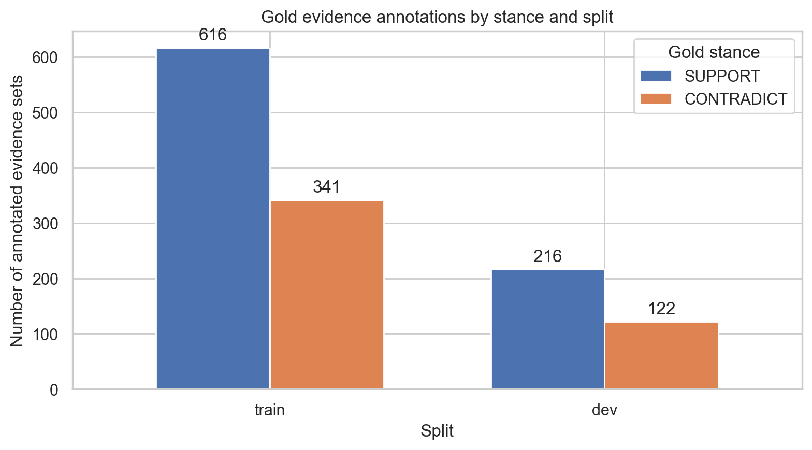

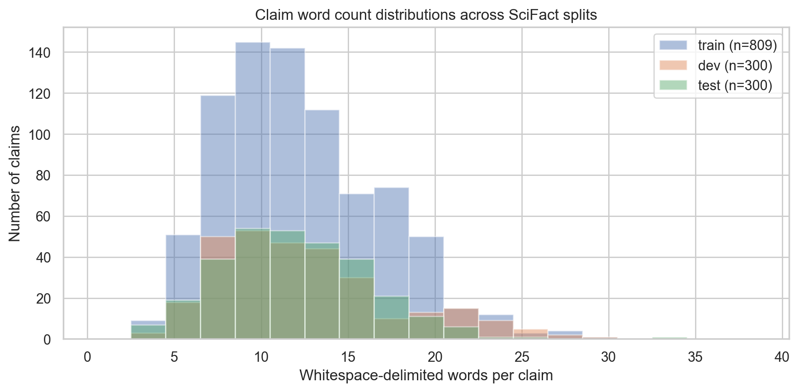

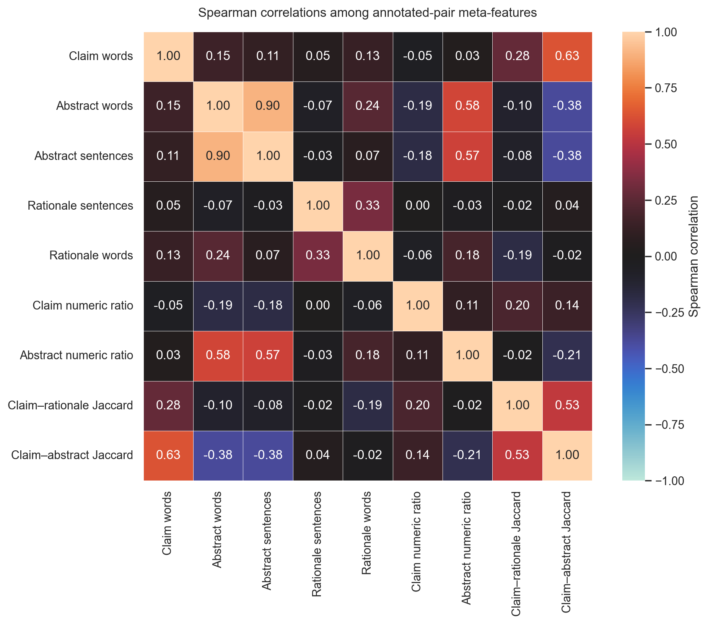

Notebook:

[02 Exploratory Data Analysis](notebooks/02_exploratory_data_analysis.ipynb)

### 3.3 Feature Engineering and Scaling

Eleven numerical features were developed for descriptive and exploratory analysis.

These include:

- Claim word and character counts.
- Numerical token ratios.
- Unique token ratios.
- Document and title lengths.
- Abstract sentence counts.
- Claim-to-document Jaccard similarity.
- TF-IDF similarity.

The feature table contains 1,258 distinct cited claim-document pairs, including 919 training pairs and 339 development pairs.

Count features undergo log transformation where appropriate. StandardScaler and MinMaxScaler are fitted exclusively on training pairs and applied unchanged to development pairs.

The numerical feature engineering experiments are separate from the final pretrained NLI pipeline. They are not presented as direct improvements to DeBERTa performance.

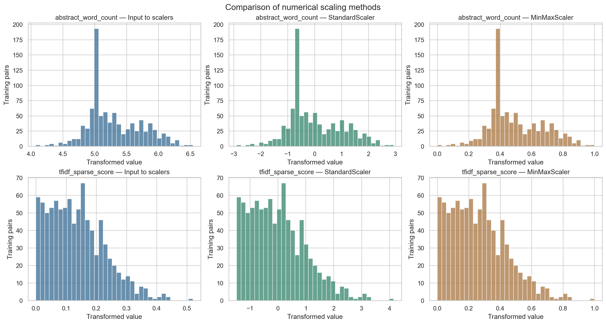

Notebook:

[03 Feature Scaling and Preprocessing](notebooks/03_feature_scaling_preprocessing.ipynb)

Detailed Phase 1 analysis:

[Phase 1 Insights](reports/Phase1_Insights.md)

## 4. Phase 2: System Architecture

The final system consists of five integrated stages.

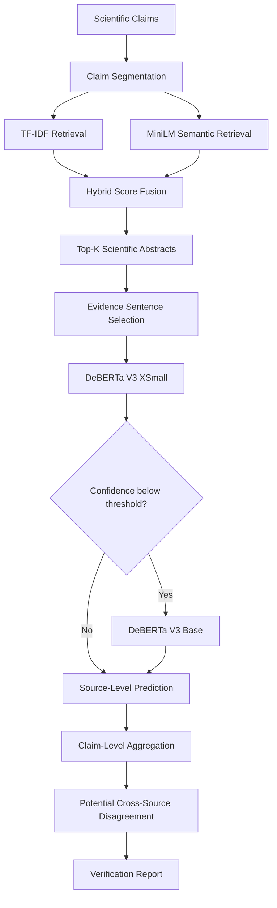

### 4.1 Claim Segmentation

A rule-based segmentation module separates input text into sentence-level claims while handling scientific abbreviations, decimal numbers, bullet points, and multiline input.

The module performs sentence-level segmentation rather than complete semantic decomposition of compound claims.

Implementation: `src/segmentation.py`

### 4.2 Hybrid Document Retrieval

The retrieval module combines:

- TF-IDF with unigram and bigram features.
- Dense embeddings from all-MiniLM-L6-v2.
- Min-max normalization of retrieval scores.
- Equal-weight lexical and semantic score fusion.

The hybrid retrieval score is:

```text
Hybrid Score = 0.5 × Lexical Score + 0.5 × Semantic Score
```

Document embeddings are cached locally to avoid repeated corpus encoding.

Implementation: `src/retrieval.py`

### 4.3 Evidence Sentence Selection

The rationale selection module compares claim embeddings with individual abstract sentence embeddings using cosine similarity.

Default settings:

- Similarity threshold: 0.40
- Maximum selected sentences: 3

When no sentence meets the threshold, the highest-scoring sentence is retained as a fallback.

Implementation: `src/rationale_selection.py`

### 4.4 Two-Tier Stance Classification

Two pretrained natural language inference models are used:

| Tier | Model |
|---|---|
| Tier 1 | cross-encoder/nli-deberta-v3-xsmall |
| Tier 2 | cross-encoder/nli-deberta-v3-base |

The evidence is provided as the NLI premise and the scientific claim as the hypothesis.

| NLI Output | Verification Label |
|---|---|
| Entailment | SUPPORT |
| Contradiction | CONTRADICT |
| Neutral | NOT_ENOUGH_INFO |

The smaller model processes each claim-evidence pair first.

When its confidence falls below the routing threshold, the larger model produces the final source-level prediction.

The models are used without SciFact-specific fine-tuning.

Implementation: `src/stance.py`

### 4.5 Claim-Level Aggregation

Individual source predictions are combined into a claim-level summary.

The system selects the highest-confidence decisive SUPPORT or CONTRADICT prediction. If no decisive prediction exists, the aggregated outcome is NOT_ENOUGH_INFO.

When different retrieved sources receive opposing decisive predictions, the system reports potential cross-source disagreement.

Such disagreement represents opposing model predictions and does not establish that the original scientific publications genuinely disagree.

Implementation: `src/pipeline.py`

## 5. Experimental Evaluation

The experiments evaluate retrieval, rationale selection, stance classification, confidence-based routing, end-to-end verification, and controlled claim-edit consistency.

### 5.1 Retrieval Ablation Study

Three retrieval configurations were evaluated on 188 gold-annotated SciFact development claims.

| Configuration | Lexical Weight | Semantic Weight |
|---|---:|---:|
| TF-IDF | 1.0 | 0.0 |
| MiniLM | 0.0 | 1.0 |
| Hybrid | 0.5 | 0.5 |

| Metric | TF-IDF | MiniLM | Hybrid |
|---|---:|---:|---:|
| Recall@1 | 62.06% | 60.55% | **68.44%** |
| Recall@3 | 80.36% | 80.43% | **83.26%** |
| Recall@5 | 85.06% | 86.85% | **89.56%** |
| Recall@10 | 89.98% | 91.17% | **96.38%** |
| Hit Rate@10 | 90.96% | 92.02% | **97.34%** |
| MRR@10 | 0.7394 | 0.7267 | **0.7943** |

Hybrid retrieval outperformed both individual configurations across all evaluated retrieval cutoffs and metrics on this development set.

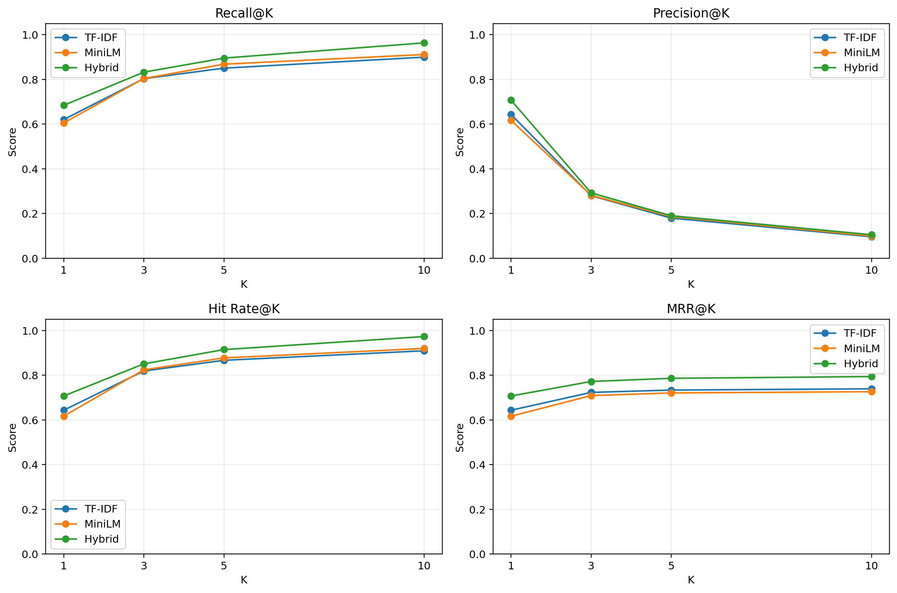

### 5.2 Evidence Sentence Selection

The rationale selection experiment uses 209 gold claim-document pairs containing 338 annotated evidence sets.

Correct annotated documents are supplied directly to isolate sentence selection from document retrieval errors.

| Metric | First-3 Baseline | MiniLM Selector |
|---|---:|---:|
| Macro Precision | 9.57% | **37.56%** |
| Macro Recall | 18.76% | **64.52%** |
| Macro F1 | 0.1192 | **0.4421** |
| Micro F1 | 0.1208 | **0.4454** |
| Sentence Hit Rate | 26.32% | **80.86%** |
| Complete Rationale Rate | 22.01% | **77.03%** |
| Exact Match Rate | 0.00% | **2.39%** |

Semantic sentence selection substantially improves evidence coverage over the positional baseline. However, its limited precision indicates that irrelevant or unannotated sentences may still be selected.

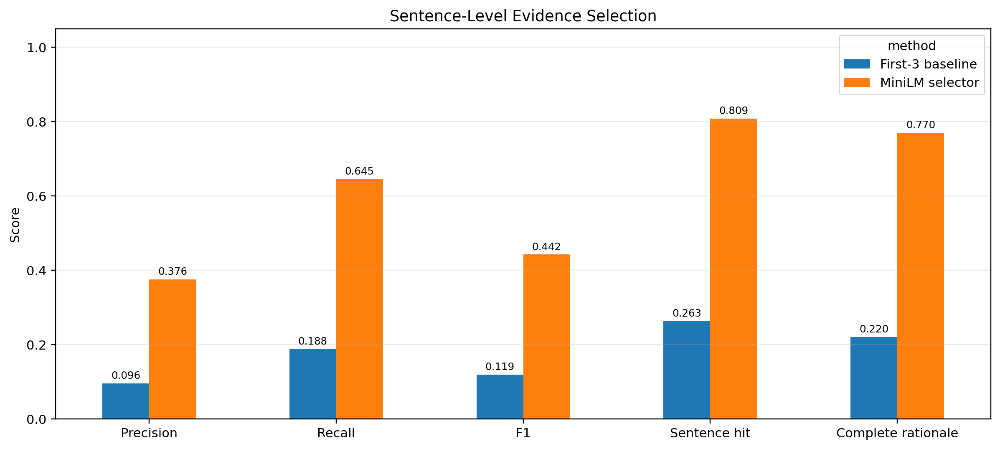

### 5.3 Stance Classification and Routing

The oracle stance experiment contains 338 human-annotated claim-rationale pairs.

| Configuration | Accuracy | Macro-F1 | Estimated Latency |
|---|---:|---:|---:|
| Majority-Class Baseline | 63.91% | 0.3899 | Not measured |
| XSmall Only | 41.12% | 0.5712 | 99.34 ms |
| Two-Tier (0.60) | 40.53% | 0.5698 | 116.93 ms |
| Two-Tier (0.80) | 42.31% | 0.5883 | 152.26 ms |
| Two-Tier (0.95) | 44.67% | 0.6106 | 222.93 ms |
| Base Only | 45.56% | 0.6250 | 266.24 ms |

At threshold 0.95:

- Larger-model usage: 45.86%.
- Estimated classifier latency reduction against standalone Base: 16.27%.
- Overall classification accuracy: 44.67%.
- Decisive prediction accuracy: 88.30%.
- Decisive prediction coverage: 50.59%.

The latency comparison is derived from saved per-pair inference measurements. It excludes retrieval, rationale selection, model initialization, and web application overhead.

The pretrained models have lower overall accuracy than the majority-class baseline but higher SUPPORT/CONTRADICT Macro-F1.

The oracle experiment does not include gold NOT_ENOUGH_INFO examples. NEI predictions are counted as errors.

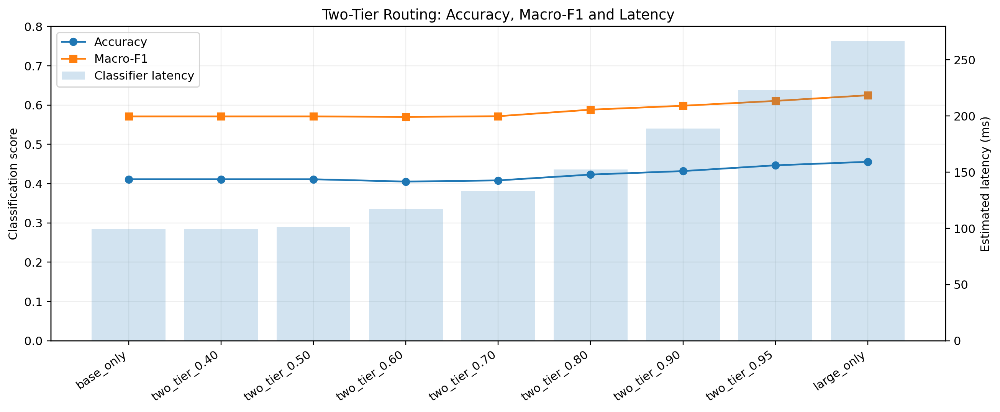

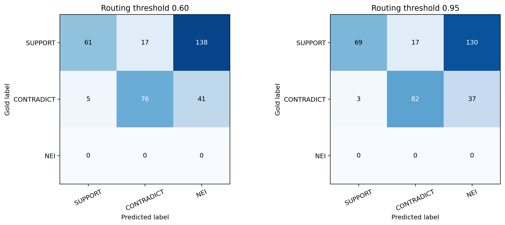

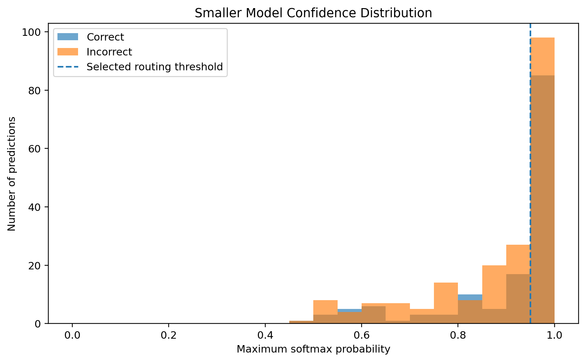

### 5.4 End-to-End Evaluation

Two routing configurations were evaluated on the same first 60 eligible gold-annotated development claims.

Unlike the oracle experiments, these evaluations use automatically retrieved documents and extracted evidence sentences.

| Metric | Threshold 0.60 | Threshold 0.95 |
|---|---:|---:|
| Accuracy | 45.00% | 43.33% |
| Macro-F1 | 0.5569 | 0.5296 |
| Gold Document Hit Rate@3 | 83.33% | 83.33% |
| Correct Label and Gold Document Hit | 38.33% | 38.33% |
| Decisive Accuracy | 71.05% | 66.67% |
| Decisive Coverage | 63.33% | 65.00% |
| Potential Cross-Source Conflicts | 4 | 4 |

At threshold 0.95, the selected source is an annotated gold document and the claim label is correct in 30.00% of evaluated cases.

Increasing the routing threshold improves oracle stance performance but does not improve the preliminary end-to-end results. This demonstrates that stronger classification on gold evidence does not necessarily compensate for imperfect evidence retrieval and selection.

The difference between configurations is small and does not establish statistical superiority.

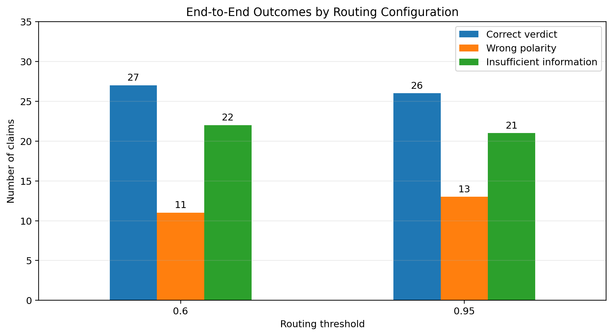

### 5.5 Controlled Claim-Edit Consistency

Five manually constructed examples were evaluated with fixed evidence sentences at the historical routing threshold of 0.60.

| Metric | Result |
|---|---:|
| Paraphrase consistency | 5/5 |
| Negation or antonym flip consistency | 5/5 |

These results demonstrate expected behavior on a small controlled example set. They do not establish general robustness or end-to-end verification accuracy.

### Detailed Experimental Results

- [Phase 2 Evaluation Notebook](notebooks/04_modeling_evaluation.ipynb)
- [Final Evaluation Report](reports/Phase2_Evaluation_Report.md)
- [Saved Evaluation Artifacts](outputs/evaluation/)

## 6. Interactive Web Application

LitScope-Lite provides a Streamlit interface that supports:

- Single and multiple scientific claims.
- Configurable retrieval cutoff.
- Configurable rationale similarity threshold.
- Configurable two-tier routing threshold.
- Claim-level and source-level predictions.
- Source titles and document identifiers.
- Extracted evidence sentences.
- Model confidence and retrieval scores.
- Potential cross-source disagreement warnings.
- Processing time and larger-model usage statistics.
- Downloadable JSON verification reports.

### Default Configuration

| Parameter | Value |
|---|---:|
| Retrieved abstracts | 3 |
| Rationale similarity threshold | 0.40 |
| Maximum rationale sentences | 3 |
| Routing threshold | 0.95 |

The routing threshold of 0.95 was selected from oracle development-set experiments. It is not a formally calibrated probability threshold.

The application has been tested locally on Windows.

No public deployment is currently provided.

## 7. Repository Structure

```text
LitScope-Lite/
├── data/
│   ├── scifact/                      # Original dataset
│   └── processed/                    # Generated Phase 1 data
├── notebooks/
│   ├── 01_data_cleaning.ipynb
│   ├── 02_exploratory_data_analysis.ipynb
│   ├── 03_feature_scaling_preprocessing.ipynb
│   └── 04_modeling_evaluation.ipynb
├── images/                           # Experimental figures
├── outputs/
│   ├── eda/
│   ├── preprocessing/
│   └── evaluation/
├── reports/
│   ├── Phase1_Insights.md
│   └── Phase2_Evaluation_Report.md
├── src/
│   ├── segmentation.py
│   ├── retrieval.py
│   ├── rationale_selection.py
│   ├── stance.py
│   ├── pipeline.py
│   ├── utils.py
│   ├── evaluate_phase2.py
│   ├── evaluate_retrieval_ablation.py
│   ├── evaluate_rationale_selection.py
│   ├── recompute_routing_metrics.py
│   ├── build_phase2_notebook.py
│   └── generate_requirements.py
├── tests/
├── web/
│   └── app.py
├── .streamlit/
│   └── config.toml
├── .env.example
├── .gitignore
├── main.py
├── requirements.txt
├── requirements-phase1.txt
└── README.md
```

Raw datasets, generated dataset copies, local model caches, and virtual environments are excluded from version control.

Saved experimental predictions, evaluation tables, notebooks, reports, and result figures are retained.

## 8. Installation and Setup

### 8.1 Prerequisites

- Python 3.10
- Internet access for initial dataset and model downloads
- Sufficient memory and disk space for pretrained models

The project was tested using Python 3.10.11 on Windows.

### 8.2 Create a Virtual Environment

Run the following commands from the repository root.

Windows PowerShell:

```powershell
py -3.10 -m venv .venv
.\.venv\Scripts\Activate.ps1
python -m pip install -r requirements.txt
```

Linux or macOS:

```bash
python3.10 -m venv .venv
source .venv/bin/activate
python -m pip install -r requirements.txt
```

The dependency file records the principal package versions used in the tested environment. PyTorch installation requirements may vary by operating system and hardware.

### 8.3 Download the Dataset

Download the official SciFact archive:

https://scifact.s3-us-west-2.amazonaws.com/release/latest/data.tar.gz

Extract the following files into `data/scifact/`:

```text
data/scifact/corpus.jsonl
data/scifact/claims_train.jsonl
data/scifact/claims_dev.jsonl
data/scifact/claims_test.jsonl
```

The pretrained models are downloaded automatically from Hugging Face when first initialized.

The initial execution may take longer because model weights must be downloaded and corpus embeddings may need to be generated.

Subsequent executions reuse locally cached model files and document embeddings.

No paid API or external inference API key is required.

## 9. Running the Application

### Web Interface

```bash
python -m streamlit run web/app.py
```

Open:

http://localhost:8501

Enter a scientific claim or a paragraph containing multiple claims and select Verify Claims.

### Command-Line Interface

```bash
python main.py --text "Vitamin D deficiency is associated with an increased risk of osteoporosis."
```

To specify an output file:

```bash
python main.py --text "Regular aerobic exercise lowers blood pressure." --output verification_report.json
```

To process a JSONL file containing claim records:

```bash
python main.py --file data/scifact/claims_dev.jsonl --output verification_report.json
```

## 10. Reproducing Experiments

### Phase 1

Execute the first three notebooks in order:

1. Data Cleaning
2. Exploratory Data Analysis
3. Feature Scaling and Preprocessing

For Phase 1 alone, the smaller dependency file may be used:

```bash
python -m pip install -r requirements-phase1.txt
```

### Phase 2

Retrieval ablation:

```bash
python -m src.evaluate_retrieval_ablation
```

Sentence-level evidence selection:

```bash
python -m src.evaluate_rationale_selection
```

Recalculate routing metrics from saved predictions:

```bash
python -m src.evaluate_phase2 --only saved-routing
```

Oracle stance evaluation with model inference:

```bash
python -m src.evaluate_phase2 --only stance
```

End-to-end evaluation at the current default routing threshold:

```bash
python -m src.evaluate_phase2 --only end-to-end --sample-size 60
```

Controlled consistency evaluation at the current routing threshold:

```bash
python -m src.evaluate_phase2 --only consistency
```

The submitted consistency results were generated using the historical threshold of 0.60. Rerunning the current evaluator uses 0.95 and may produce different results.

Inference-based evaluations can overwrite their corresponding saved output files. Preserve existing experimental artifacts before rerunning them.

The historical 0.60 end-to-end predictions are retained separately as `end_to_end_threshold_060.csv`.

### Regenerate the Phase 2 Notebook

The submitted notebook already contains executed cells, result tables, and figures.

To regenerate its outputs from the saved evaluation artifacts:

```bash
python -m ipykernel install --user --name litscope-lite --display-name "Python (LitScope-Lite)"
python -m src.build_phase2_notebook
```

Notebook regeneration does not require additional model inference or training.

## 11. Automated Testing

Run the deterministic segmentation and claim-aggregation tests:

```bash
python -m pytest tests/test_segmentation.py tests/test_pipeline_summary.py -v
```

Verified result:

```text
11 passed
```

The Phase 2 evaluation notebook was also executed successfully, with all 11 code cells completing without execution errors.

## 12. Limitations

- General-domain NLI models are not fine-tuned on scientific verification data.
- Overall stance classification accuracy remains limited.
- Model confidence is not formally calibrated.
- High-confidence predictions can occur with irrelevant evidence.
- Sentence-level evidence selection may omit relevant context or include unrelated sentences.
- The oracle stance experiment does not contain gold NEI examples.
- Quantitative experiments use development data rather than an independent labeled test set.
- End-to-end evaluation uses a nonrandom subset of 60 claims.
- Controlled consistency experiments contain only five examples.
- Potential cross-source disagreement requires manual interpretation.
- The corpus is limited and does not represent all scientific literature.

## 13. Future Work

Potential extensions include:

- Fine-tuning NLI models on scientific claim-evidence pairs.
- Confidence calibration and improved uncertainty handling.
- Explicit evidence relevance rejection.
- More sophisticated evidence aggregation.
- Complete three-class verification evaluation.
- Independent benchmark evaluation.
- Full-document scientific comparison.

## 14. Conclusion

LitScope-Lite demonstrates a modular approach to scientific evidence retrieval and claim verification using pretrained NLP models.

The retrieval ablation study establishes the benefit of combining lexical and semantic retrieval on the evaluated development claims. Semantic evidence selection also substantially outperforms the positional baseline.

Confidence-based model routing provides a measurable classifier latency and performance trade-off, although scientific stance classification remains a major limitation.

The end-to-end results highlight the importance of evaluating evidence quality separately from classification accuracy.

The completed system provides an interactive, traceable research prototype and a reproducible experimental framework for investigating scientific claim verification.

## References

1. Wadden et al. Fact or Fiction: Verifying Scientific Claims. EMNLP 2020.
   https://aclanthology.org/2020.emnlp-main.609/

2. AllenAI SciFact.
   https://github.com/allenai/scifact

3. Sentence Transformers MiniLM.
   https://huggingface.co/sentence-transformers/all-MiniLM-L6-v2

4. DeBERTa V3 XSmall NLI.
   https://huggingface.co/cross-encoder/nli-deberta-v3-xsmall

5. DeBERTa V3 Base NLI.
   https://huggingface.co/cross-encoder/nli-deberta-v3-base
