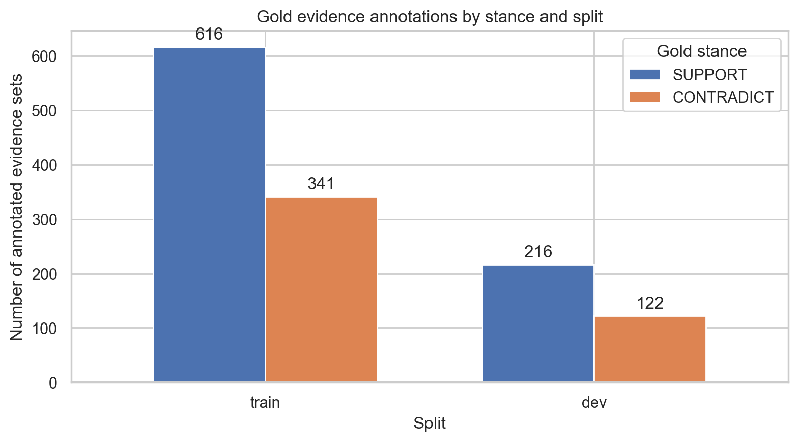
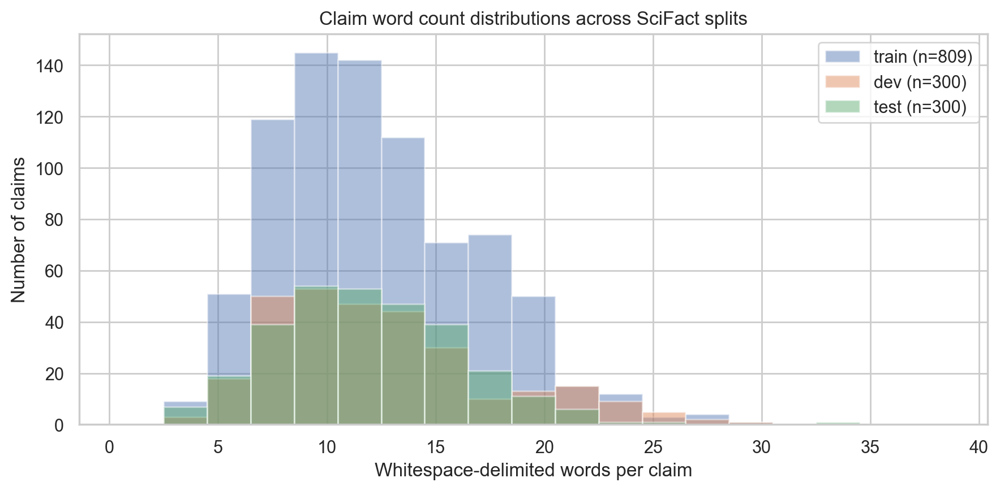
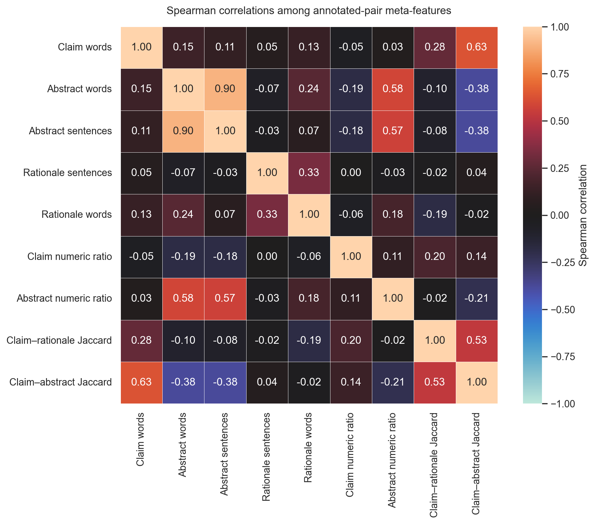
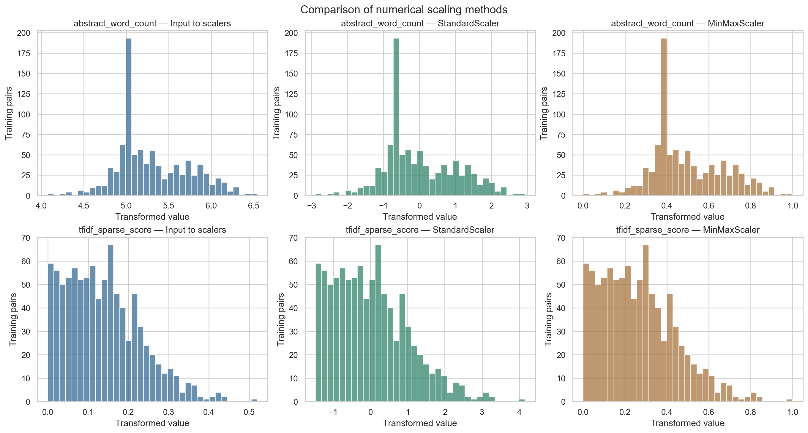

# LitScope-Lite

**Evidence-Based Verification of Scientific Claims Using NLP**

LitScope-Lite is a research-oriented natural language processing project that investigates verification of scientific claims against evidence from scientific abstracts. The proposed pipeline combines claim segmentation, lexical and semantic evidence retrieval, sentence-level rationale selection, and stance classification. Its design also considers confidence-based review and comparison of evidence across retrieved sources. The project is an experimental verification framework, **not** a system for establishing scientific truth.

This repository contains the **Phase 1 data-science work**: data quality auditing, non-destructive cleaning, exploratory data analysis (EDA), interpretable feature engineering, and numerical preprocessing. The notebooks do **not** train, tune, or evaluate a claim-verification model. The existing modules under `src/` are separate from the Phase 1 analyses.

## Problem statement and research objectives

Scientific literature is large and often difficult to search and compare. A scientific claim may require evidence from several publications, and related evidence may support, contradict, or fail to address the claim. LitScope-Lite investigates whether a compute-conscious sequence of claim segmentation, evidence retrieval, rationale selection, and stance assessment can organize evidence-grounded verification. The work emphasizes traceable source evidence, explicit uncertainty, and reproducible analysis.

## Dataset: SciFact

**Source:** [AllenAI SciFact repository](https://github.com/allenai/scifact)  
**Official download:** [SciFact dataset archive](https://scifact.s3-us-west-2.amazonaws.com/release/latest/data.tar.gz)  
**Schema reference:** [SciFact data format](https://github.com/allenai/scifact/blob/master/doc/data.md)

The supplied dataset consists of **5,183 scientific abstracts**, represented as **45,952 sentence entries**, and **1,409 scientific claims** divided into the following official splits:

| Dataset file | Records | Description |
| --- | ---: | --- |
| `corpus.jsonl` | 5,183 | Scientific documents, each with an ID, title, abstract sentence list, and `structured` field |
| `claims_train.jsonl` | 809 | Training claims with available citation and evidence metadata |
| `claims_dev.jsonl` | 300 | Development claims with available citation and evidence metadata |
| `claims_test.jsonl` | 300 | Unlabeled test claims |

**Original fields.** Corpus records contain `doc_id`, `title`, `abstract`, and `structured`. The claim files include `id` and `claim`; the training and development records also provide `evidence` and `cited_doc_ids`. The supplied test claims contain no gold labels or cited-document lists.

**Verification target.** The prospective verification task distinguishes `SUPPORT`, `CONTRADICT`, and insufficient evidence. However, **SciFact's released gold rationale annotations explicitly use only `SUPPORT` and `CONTRADICT`**. Claims without listed gold evidence and cited document pairs without annotation are **not automatically treated as verified `NOT_ENOUGH_INFO` examples**. Evidence annotation counts must not be mistaken for distinct claim counts.

The original source files are kept in `data/scifact/`. Cleaned, schema-compatible copies are generated in `data/processed/`. The raw source files can be recovered from the official download if they are not stored in the Git repository. Dataset use and redistribution remain subject to the [SciFact data licenses](https://github.com/allenai/scifact/blob/master/LICENSE.md).

## Phase 1 methodology

### 1. Data auditing and cleaning

Notebook: `01_data_cleaning.ipynb`

- Validate JSONL structure, required text fields, document identifiers, cited-document references, and evidence sentence indices.
- Normalize text with Unicode NFC and whitespace standardization while preserving biomedical terminology and original field structure.
- Identify duplicated text, very short or unusually long sentences, and probable extraction artifacts.
- Record anomalies in dedicated audit tables; **do not delete or reorder abstract sentences** because gold rationales reference sentence indices.
- Export cleaned JSONL files with unchanged record counts, split assignment, document IDs, and evidence references.

**Observed results:** 3,843 text strings normalized; 0 missing or invalid required fields; 0 invalid evidence references. The quality audit flagged 808 repeated abstract sentence occurrences, 1,083 one- or two-word sentences, and 1,356 sentences above the 46-word IQR upper fence. These flag categories overlap and are **not** counts of removed observations. Three highly repetitive documents were retained and flagged for inspection.

### 2. Exploratory data analysis

Notebook: `02_exploratory_data_analysis.ipynb`

EDA covers class-annotation frequencies, annotation coverage, claim/abstract lengths, evidence rationale lengths, lexical overlap, cited-document counts, rank correlations, cross-split claim-text overlap, and data-quality indicators. Tables and figures are generated from the cleaned dataset.

### 3. Feature engineering and numerical preprocessing

Notebook: `03_feature_scaling_preprocessing.ipynb`

The principal feature table has **one row per distinct cited claim–document pair**, yielding **919 training pairs** and **339 development pairs** (1,258 total). The 11 numerical features are:

| Feature group | Features |
| --- | --- |
| Claim size and composition | `claim_word_count`, `claim_char_count`, `claim_numeric_token_ratio`, `claim_unique_token_ratio` |
| Document size and composition | `title_word_count`, `abstract_word_count`, `abstract_sentence_count`, `abstract_numeric_token_ratio` |
| Lexical relevance | `claim_abstract_jaccard`, `claim_title_jaccard`, `tfidf_sparse_score` |

The five count features undergo `log1p` transformation. `StandardScaler` and `MinMaxScaler` are fitted on **training claim–document pairs only**, then applied unchanged to the development pairs. Gold stance and annotation status are excluded from the numerical predictors. A separate claim-level feature table includes all 1,409 claims, including test claims. The supplied test split has no cited-document IDs; no synthetic test pairs are created.

The TF-IDF score is a **lexical similarity feature**, not a stance label or model-performance metric. Dense embedding similarity is not included in this table because aligned claim embeddings were not supplied. These dataset-level transformations are distinct from per-query score normalization used by the existing retrieval module.

## Key data findings

| Observation | Measured finding | Interpretation |
| --- | --- | --- |
| Gold evidence stance frequency | 832 `SUPPORT` (64.2%) and 463 `CONTRADICT` (35.8%) annotations | Annotated evidence has a stance imbalance; later classification assessment should report per-class and macro-averaged metrics. |
| Claims without listed gold evidence | 304/809 train and 112/300 dev claims | Missing annotations require explicit treatment; absence of a gold evidence entry is not a confirmed NEI label. |
| Typical text lengths | Median claim: 12 words; median abstract: 192 words and 8 sentences | Claims are brief relative to the evidence documents; length-aware indexing and rationale selection are relevant design considerations. |
| Evidence rationale extent | 1,210 of 1,295 annotated rationales use one sentence (93.4%) | Most gold rationales are sentence-local; multiple-sentence examples should still be retained. |
| Length-feature association | Spearman ρ = 0.900 between abstract word count and sentence count in the gold-annotated descriptive feature table | Length features are highly related; correlation does not imply causation or justify discarding a feature without experiments. |
| Lexical overlap with rationales | Median Jaccard: `SUPPORT` ≈ 0.105; `CONTRADICT` ≈ 0.095 | Lexical overlap alone does not determine stance. |
| Training-pair TF-IDF similarity | Median ≈ 0.127 (919 cited training pairs) | Sparse-score distributions can be inspected before future retrieval evaluations; this is not a recall or accuracy estimate. |
| Cross-split exact-text overlap | 2 distinct shared claims (train/dev), 1 (train/test), 0 (dev/test) | Potential evaluation leakage should be checked in later modeling; supplied split memberships remain unchanged. |

For complete evidence definitions, plot interpretations, data-quality considerations, and limitations, see **[Phase 1 Insights and Methodology](reports/Phase1_Insights.md)**.

### Selected figures

**Evidence-annotation stance frequencies.** `SUPPORT` is more frequent than `CONTRADICT` across the labeled train/dev annotations.



**Claim length distribution.** Claims cluster around shorter lengths, with a right tail.



**Descriptive feature correlations.** The highest observed absolute rank correlation relates abstract word and sentence counts.



**Feature scaling.** Standard and min–max scaling change feature magnitudes and ranges; they do not establish an improvement in prediction quality.



A full figure index with an interpretation for every visualization appears in the [insights report](reports/Phase1_Insights.md).

## Repository layout

```text
LitScope-Lite/
├── data/
│   ├── scifact/                  # Original SciFact JSONL files (local source)
│   └── processed/                # Cleaned JSONL and engineered/scaled data
├── notebooks/
│   ├── 01_data_cleaning.ipynb
│   ├── 02_exploratory_data_analysis.ipynb
│   └── 03_feature_scaling_preprocessing.ipynb
├── images/                       # Data-cleaning, EDA and preprocessing figures
├── outputs/
│   ├── eda/                      # Descriptive CSVs and summary JSON
│   └── preprocessing/            # Feature summary tables and checks
├── reports/
│   └── Phase1_Insights.md
├── src/                          # Existing verification modules
├── tests/                        # Existing module tests
├── requirements-phase1.txt       # Libraries required for Phase 1 notebooks
└── requirements.txt              # Existing broader project dependency list
```

The notebooks and figures are the reproducible Phase 1 deliverables. Generated data may be maintained directly in the repository or recreated using the notebooks if excluded by `.gitignore`.

## Reproducing Phase 1

**Prerequisites:** Python 3.10+ and VS Code with the Microsoft Python and Jupyter extensions (or a compatible Jupyter environment). Run the commands below from the repository root.

### 1. Set up the Python environment

In a **Windows PowerShell** terminal, use an existing `.venv` or create one if needed:

```powershell
py -m venv .venv
.\.venv\Scripts\python.exe -m pip install -r requirements-phase1.txt
```

If the virtual environment already exists, skip the first command. `requirements-phase1.txt` deliberately provides only the libraries needed to reproduce the data-science notebooks; broader inference dependencies are maintained separately.

### 2. Prepare the source files

Obtain the official [SciFact dataset archive](https://scifact.s3-us-west-2.amazonaws.com/release/latest/data.tar.gz) if the raw JSONL files are not already present. Place the four files under `data/scifact/`:

```text
data/scifact/corpus.jsonl
data/scifact/claims_train.jsonl
data/scifact/claims_dev.jsonl
data/scifact/claims_test.jsonl
```

Other SciFact content, including the official `cross_validation/` folds, can remain in place and is not required for these Phase 1 notebooks.

### 3. Run the notebooks in order

Open each notebook in VS Code, select the repository `.venv` interpreter as its **Jupyter kernel**, and choose **Run All**:

1. `notebooks/01_data_cleaning.ipynb`: produces the schema-preserving cleaned files and quality audit tables under `data/processed/`.
2. `notebooks/02_exploratory_data_analysis.ipynb`: reads the cleaned files and saves statistical tables under `outputs/eda/` and graphs under `images/`.
3. `notebooks/03_feature_scaling_preprocessing.ipynb`: reads the cleaned files, generates raw/scaled features, and exports fitted transformers and figures under `data/processed/`, `outputs/preprocessing/`, and `images/`.

Each notebook includes integrity assertions and displays `PASS` status lines on successful completion. Keep the executed notebook outputs visible when committing.

### Principal derived artifacts

- `data/processed/corpus_clean.jsonl` and `claims_*_clean.jsonl`: schema-compatible cleaned dataset.
- `data/processed/cleaning_summary.json`: cleaning counts, decisions, and raw/processed input checksums.
- `data/processed/scifact_features_raw.csv`: cited claim–document features before numerical scaling.
- `data/processed/scifact_features_scaled.csv`: training-fitted standard and min–max feature representations.
- `data/processed/scifact_claim_features.csv`: claim-only features for all splits.
- `data/processed/scifact_scalers.joblib`: fitted numerical transformers.
- `outputs/eda/eda_summary.json`: EDA metrics and figure inventory.
- `outputs/preprocessing/03_preprocessing_summary.json`: preprocessing statistics.

## Scope and limitations

- All statistical findings describe the supplied SciFact files, not general performance on arbitrary scientific literature.
- Annotation counts differ from distinct claim counts; missing gold evidence is not a verified negative or NEI label.
- The test split is unlabeled; no gold-label testing, threshold tuning, or model evaluation is performed in Phase 1.
- Several abstract extraction anomalies are **flagged**, not automatically repaired; sentence indices and source annotation mappings are preserved.
- The feature-table analysis uses **cited** training/development claim–document pairs, not a random or fully representative sample of all possible query–document pairs.
- Numeric scaling is fitted on training data only, with no claim that scaling improves retrieval or stance classification by itself.

## Project team

- M. Auon Naseer: 23L-0643
- M. Mustafa Khan: 23L-0596
- Zeeshan Zahid: 23L-0645

## Citation

SciFact: David Wadden, Shanchuan Lin, Kyle Lo, Lucy Lu Wang, Madeleine van Zuylen, Arman Cohan, and Hannaneh Hajishirzi. **“Fact or Fiction: Verifying Scientific Claims.”** *EMNLP*, 2020. [Original SciFact repository](https://github.com/allenai/scifact).
