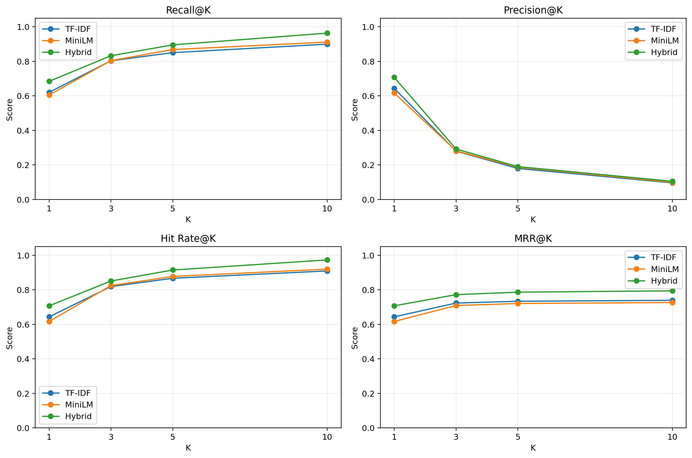
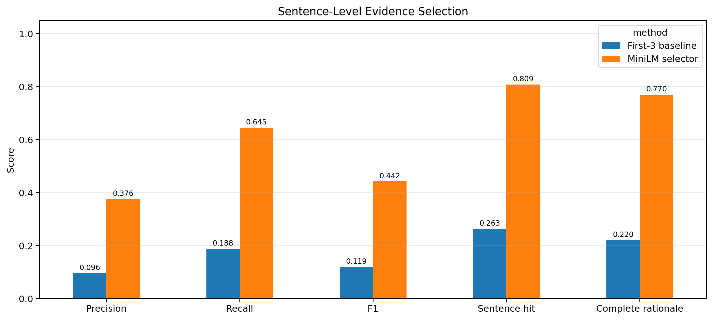
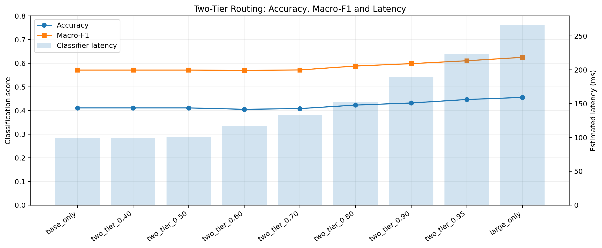
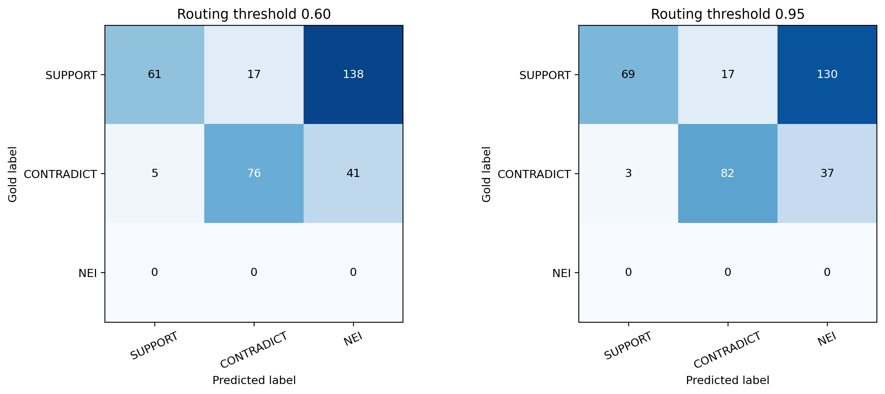
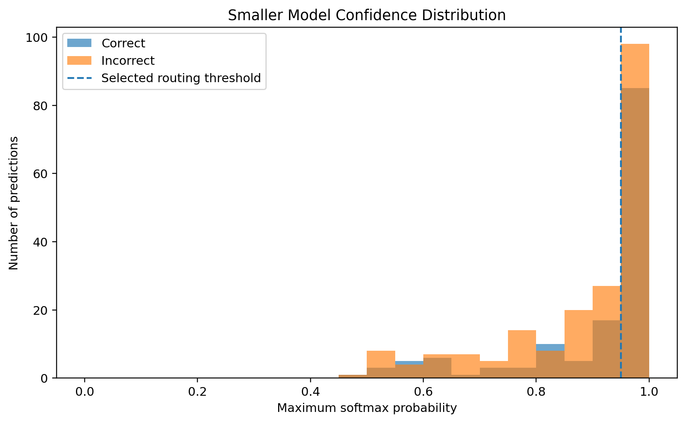
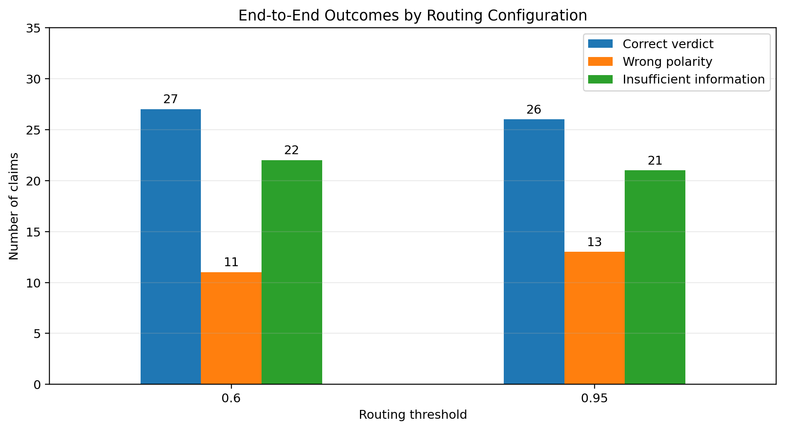


# LitScope-Lite

## Phase 2: Modeling and Experimental Evaluation Report

## 1. Introduction

LitScope-Lite investigates evidence-based verification of scientific claims through a modular natural language processing pipeline.

The project examines the effectiveness of lexical and semantic document retrieval, sentence-level evidence selection, pretrained natural language inference, and confidence-based model routing.

The primary objective is to investigate the strengths and limitations of a computationally practical scientific verification pipeline rather than establish scientific truth.

## 2. Experimental Setup

### 2.1 Dataset

The AllenAI SciFact benchmark is used for experimental evaluation.

The corpus contains 5,183 scientific abstracts and 1,409 claims distributed across 809 training, 300 development, and 300 test examples.

Quantitative Phase 2 experiments use the development split because the supplied test split does not contain gold verification labels.

| Experiment | Evaluation Units |
|---|---:|
| Document retrieval | 188 annotated claims |
| Rationale selection | 209 claim-document pairs |
| Oracle stance classification | 338 claim-rationale pairs |
| End-to-end verification | 60 annotated claims |
| Controlled consistency | 5 constructed examples |

The evaluation units differ across experiments because individual claims may have multiple annotated documents and multiple evidence sets.

### 2.2 Models

| Component | Method |
|---|---|
| Lexical retrieval | TF-IDF |
| Semantic retrieval | all-MiniLM-L6-v2 |
| Sentence selection | MiniLM cosine similarity |
| Tier 1 classification | DeBERTa V3 XSmall NLI |
| Tier 2 classification | DeBERTa V3 Base NLI |
| Web application | Streamlit |

The pretrained models are used without SciFact-specific fine-tuning.

### 2.3 Default Pipeline Configuration

| Parameter | Value |
|---|---:|
| Lexical retrieval weight | 0.50 |
| Semantic retrieval weight | 0.50 |
| Retrieval cutoff | 3 |
| Rationale similarity threshold | 0.40 |
| Maximum rationale sentences | 3 |
| Routing threshold | 0.95 |

The routing threshold was selected through development-set oracle stance experiments.

It is not a formally calibrated estimate of prediction correctness.

## 3. Document Retrieval Evaluation

### 3.1 Methodology

The retrieval experiment compares three configurations on the same 188 gold-annotated development claims:

1. TF-IDF lexical retrieval.
2. MiniLM semantic retrieval.
3. Equal-weight hybrid retrieval.

The experiments evaluate retrieval cutoffs of 1, 3, 5, and 10 documents.

Recall measures the fraction of annotated relevant documents retrieved. Precision measures the fraction of retrieved documents that are annotated as relevant.

Hit rate indicates whether at least one gold document was retrieved.

Mean reciprocal rank evaluates the position of the first retrieved gold document.

All metrics are macro-averaged across claims.

### 3.2 Results

| Method | K | Recall | Precision | Hit Rate | MRR |
|---|---:|---:|---:|---:|---:|
| TF-IDF | 1 | 0.6206 | 0.6436 | 0.6436 | 0.6436 |
| TF-IDF | 3 | 0.8036 | 0.2801 | 0.8191 | 0.7234 |
| TF-IDF | 5 | 0.8506 | 0.1798 | 0.8670 | 0.7338 |
| TF-IDF | 10 | 0.8998 | 0.0963 | 0.9096 | 0.7394 |
| MiniLM | 1 | 0.6055 | 0.6170 | 0.6170 | 0.6170 |
| MiniLM | 3 | 0.8043 | 0.2819 | 0.8245 | 0.7092 |
| MiniLM | 5 | 0.8685 | 0.1872 | 0.8777 | 0.7212 |
| MiniLM | 10 | 0.9117 | 0.1000 | 0.9202 | 0.7267 |
| Hybrid | 1 | 0.6844 | 0.7074 | 0.7074 | 0.7074 |
| Hybrid | 3 | 0.8326 | 0.2926 | 0.8511 | 0.7722 |
| Hybrid | 5 | 0.8956 | 0.1904 | 0.9149 | 0.7865 |
| Hybrid | 10 | 0.9638 | 0.1053 | 0.9734 | 0.7943 |



### 3.3 Analysis

Hybrid retrieval outperformed both individual methods across all evaluated cutoffs and metrics.

At K = 10, hybrid retrieval improves recall by 5.21 percentage points over the strongest individual retrieval configuration.

The MRR@10 of 0.7943 also exceeds the individual lexical and semantic configurations.

These results indicate that exact terminology matching and semantic similarity provide complementary retrieval signals within the evaluated benchmark.

All historical hybrid recall values were reproduced exactly during the ablation experiment.

Precision decreases as the retrieval cutoff increases because additional candidate documents are retrieved. Unannotated documents should not automatically be interpreted as irrelevant because the benchmark annotations may be incomplete.

The findings support hybrid retrieval as the default configuration, but they do not establish generalization across other scientific domains.

## 4. Evidence Sentence Selection

### 4.1 Methodology

The rationale selection experiment isolates sentence extraction from document retrieval errors by supplying the correct annotated abstract directly.

The evaluation contains:

- 188 unique annotated claims.
- 209 claim-document pairs.
- 338 annotated rationale sets.

The semantic selector uses cosine similarity between claim and sentence embeddings.

The default similarity threshold is 0.40, with a maximum of three selected sentences.

If no sentence reaches the similarity threshold, the highest-scoring sentence is selected as a fallback.

The baseline selects the first three nonempty abstract sentences.

Gold sentence indices are preserved throughout evaluation.

### 4.2 Evaluation Metrics

Precision, recall, and F1 are calculated against the union of annotated sentence indices for each claim-document pair.

Sentence hit rate indicates whether at least one annotated evidence sentence was selected.

Exact match measures whether the predicted sentence set exactly matches the union of annotated sentences.

Complete rationale coverage indicates whether at least one complete annotated rationale set is contained in the predicted sentences.

### 4.3 Results

| Metric | First-3 Baseline | MiniLM Selector |
|---|---:|---:|
| Macro Precision | 0.0957 | 0.3756 |
| Macro Recall | 0.1876 | 0.6452 |
| Macro F1 | 0.1192 | 0.4421 |
| Micro F1 | 0.1208 | 0.4454 |
| Sentence Hit Rate | 0.2632 | 0.8086 |
| Complete Rationale Rate | 0.2201 | 0.7703 |
| Exact Match Rate | 0.0000 | 0.0239 |
| Mean Selected Sentences | 3.0000 | 2.8038 |

The semantic selector required its below-threshold fallback in one of the 209 evaluated gold claim-document pairs.



### 4.4 Analysis

The semantic selector achieves approximately 3.71 times the Macro-F1 of the positional baseline.

It selects at least one gold evidence sentence in 80.86% of evaluated claim-document pairs and captures at least one complete annotated rationale set in 77.03%.

Nevertheless, precision remains limited. The semantic selector may include additional sentences that are irrelevant or not annotated as evidence.

The low exact match rate also indicates that precise evidence extraction remains challenging.

These results represent oracle-document evidence selection and should not be interpreted as end-to-end rationale extraction performance.

## 5. Oracle Stance Classification

### 5.1 Methodology

The stance classification experiment evaluates two pretrained NLI models using 338 gold claim-rationale pairs.

The gold-label distribution contains:

- 216 SUPPORT examples.
- 122 CONTRADICT examples.

The evidence sentence or rationale is supplied as the premise, while the scientific claim is supplied as the hypothesis.

The NLI output is mapped to SUPPORT, CONTRADICT, or NOT_ENOUGH_INFO.

The experiment does not contain gold NEI examples. Therefore, NEI predictions are treated as classification errors.

Macro-F1 averages the SUPPORT and CONTRADICT class F1 scores.

### 5.2 Majority-Class Baseline

A baseline that predicts SUPPORT for every example achieves:

| Metric | Result |
|---|---:|
| Accuracy | 63.91% |
| Macro-F1 | 0.3899 |

This baseline provides a necessary reference for interpreting the pretrained classifiers.

### 5.3 Confidence-Based Routing Experiment

The smaller model processes each pair first.

If its maximum softmax probability falls below the routing threshold, the larger model supplies the final prediction.

Nine configurations, including standalone model baselines, are evaluated.

| Configuration | Accuracy | Macro-F1 | Larger-Model Usage | Latency |
|---|---:|---:|---:|---:|
| XSmall Only | 0.4112 | 0.5712 | 0.0000 | 99.34 ms |
| Two-Tier 0.40 | 0.4112 | 0.5712 | 0.0000 | 99.34 ms |
| Two-Tier 0.50 | 0.4112 | 0.5712 | 0.0059 | 100.87 ms |
| Two-Tier 0.60 | 0.4053 | 0.5698 | 0.0651 | 116.93 ms |
| Two-Tier 0.70 | 0.4083 | 0.5717 | 0.1272 | 133.11 ms |
| Two-Tier 0.80 | 0.4231 | 0.5883 | 0.2012 | 152.26 ms |
| Two-Tier 0.90 | 0.4320 | 0.5983 | 0.3284 | 188.68 ms |
| Two-Tier 0.95 | 0.4467 | 0.6106 | 0.4586 | 222.93 ms |
| Base Only | 0.4556 | 0.6250 | 1.0000 | 266.24 ms |



### 5.4 Latency Evaluation

Standalone model latency is calculated using the saved inference time of that model alone.

For routed inference, total classifier latency is calculated as:

```text
Routed Latency = XSmall Latency + Escalation Indicator × Base Latency
```

At threshold 0.95:

- Standalone Base latency: 266.24 ms.
- Two-tier latency: 222.93 ms.
- Estimated classifier latency reduction: 16.27%.
- Accuracy difference: 0.89 percentage points.

The two-tier configuration approaches the standalone larger model's measured accuracy while reducing estimated classifier inference latency.

These estimates exclude retrieval, evidence selection, model loading, and application overhead.

Both models are initialized in memory. Consequently, the latency reduction does not demonstrate reduced model memory requirements.

### 5.5 Confusion Matrix Analysis

The following confusion matrix corresponds to routing threshold 0.95.

| Gold / Predicted | SUPPORT | CONTRADICT | NEI |
|---|---:|---:|---:|
| SUPPORT | 69 | 17 | 130 |
| CONTRADICT | 3 | 82 | 37 |

The prediction outcomes are:

| Outcome | Count | Percentage |
|---|---:|---:|
| Correct decisive prediction | 151 | 44.67% |
| Incorrect decisive prediction | 20 | 5.92% |
| NEI prediction | 167 | 49.41% |

Among the 171 decisive predictions, 151 are correct.

| Metric | Result |
|---|---:|
| Overall accuracy | 44.67% |
| Decisive prediction coverage | 50.59% |
| Decisive prediction accuracy | 88.30% |

Decisive prediction accuracy is conditional on the classifier returning SUPPORT or CONTRADICT. It is not overall verification accuracy.





### 5.6 Interpretation

The dominant observed error mode is predicting NEI on examples with annotated SUPPORT or CONTRADICT evidence.

Although the pretrained classifiers achieve higher two-class Macro-F1 than the majority baseline, their overall accuracy is lower.

This demonstrates limitations in applying general-domain NLI models directly to scientific claims.

Confidence-based routing provides a measurable performance-computation trade-off, but it does not fully address the scientific domain gap.

The routing threshold represents threshold selection rather than formal confidence calibration.

## 6. End-to-End Verification

### 6.1 Methodology

The end-to-end experiment evaluates the integrated pipeline without supplying gold documents or gold rationale sentences.

For each claim, the system:

1. Retrieves the top three abstracts.
2. Selects up to three relevant sentences per abstract.
3. Produces a source-level stance prediction.
4. Aggregates the source-level predictions.
5. Identifies potential opposing source predictions.

The aggregated verdict is the highest-confidence decisive prediction. When no decisive prediction exists, the outcome is NEI.

The evaluation uses the first 60 eligible gold-annotated development claims.

Two routing thresholds are compared:

- Historical configuration: 0.60.
- Current default configuration: 0.95.

Identical claim IDs, claim texts, and gold labels were verified across both experiments.

### 6.2 Results

| Metric | Threshold 0.60 | Threshold 0.95 |
|---|---:|---:|
| Evaluated Claims | 60 | 60 |
| Accuracy | 0.4500 | 0.4333 |
| Macro-F1 | 0.5569 | 0.5296 |
| Gold Document Hit Rate@3 | 0.8333 | 0.8333 |
| Joint Label and Gold Document Hit | 0.3833 | 0.3833 |
| Decisive Coverage | 0.6333 | 0.6500 |
| Decisive Accuracy | 0.7105 | 0.6667 |
| Correct Predictions | 27 | 26 |
| Wrong Polarity Predictions | 11 | 13 |
| NEI Predictions | 22 | 21 |
| Potential Source Conflicts | 4 | 4 |



### 6.3 Evidence Grounding Analysis

Correct claim labels do not necessarily establish that the system used relevant scientific evidence.

At threshold 0.95:

| Evaluation Criterion | Correct Cases | Rate |
|---|---:|---:|
| Correct claim label | 26/60 | 43.33% |
| Correct label and any gold document retrieved | 23/60 | 38.33% |
| Correct label and selected source is gold | 18/60 | 30.00% |

The stricter selected-source criterion requires that the document responsible for the aggregated verdict is an annotated gold document.

Even this criterion does not establish exact sentence-level evidence grounding.

### 6.4 Interpretation

Increasing the routing threshold improves oracle stance classification but does not improve the integrated end-to-end results.

One plausible explanation is that imperfect retrieval and sentence selection introduce evidence noise that stronger classification alone cannot resolve.

However, the experiment does not isolate this causal relationship.

The observed accuracy difference represents only one additional correct claim under threshold 0.60. The small, nonrandom evaluation sample does not establish statistical superiority.

The current default threshold remains 0.95 based on the oracle routing study, while both routing configurations remain selectable.

## 7. Controlled Claim-Edit Consistency

Five manually constructed biomedical examples are used to investigate classifier behavior under controlled wording changes.

Fixed evidence sentences are supplied directly to the classifier.

Each example includes an original claim, a paraphrased claim, and a negation or antonym-based claim edit.

The historical experiment uses routing threshold 0.60.

| Metric | Result |
|---|---:|
| Paraphrase consistency | 5/5 |
| Negation or antonym flip consistency | 5/5 |

All five examples demonstrate the expected stance consistency and polarity changes.

However, the limited sample size and manually constructed evidence prevent general robustness conclusions.

This experiment does not evaluate the full retrieval pipeline.

## 8. Cross-Source Disagreement Analysis

The pipeline compares predictions associated with individual retrieved sources.

A potential conflict is flagged when at least one source receives a SUPPORT prediction and another receives a CONTRADICT prediction.

Four such cases were observed in each end-to-end configuration.

The web application explicitly presents these potential disagreements alongside the corresponding extracted evidence.

Opposing model predictions do not necessarily establish genuine disagreement between scientific publications.

Sources may address different populations, experimental conditions, or outcomes. Classification errors may also produce apparent conflicts.

Therefore, this capability is presented as preliminary disagreement detection requiring manual scientific review.

## 9. Qualitative Error Analysis

During manual website testing, the following claim was evaluated:

"0-dimensional biomaterials lack inductive properties."

The retrieved sources discussed developmental patterning, periosteal bone formation, and receptor-ligand interactions.

The extracted evidence appeared poorly aligned with the specific biomaterials claim, yet all three sources received CONTRADICT predictions with confidence exceeding 98%.

The demonstration used routing threshold 0.85.

This observation illustrates two important failure modes:

1. Relative retrieval scores do not guarantee substantive evidence relevance.
2. High classification confidence does not guarantee correct scientific verification.

The example is a qualitative observation rather than an additional benchmark evaluation.

It motivates improved evidence relevance assessment and uncertainty handling.

## 10. Application Implementation and Testing

The Streamlit application supports configurable retrieval and routing parameters, evidence presentation, claim-level aggregation, potential source disagreement warnings, and downloadable verification reports.

Local execution was successfully verified.

The first application initialization downloads pretrained model weights and may generate corpus embeddings.

Subsequent requests reuse cached models and embeddings where available.

Automated deterministic tests cover:

- Single and multiple sentence segmentation.
- Scientific abbreviations and decimal values.
- Bullet points and multiline text.
- Empty input.
- Supporting and contradicting source predictions.
- Opposing source predictions.
- NEI-only evidence.
- Empty evidence.
- Preference for decisive predictions during aggregation.

All 11 selected automated tests passed.

The final Phase 2 notebook also completed all 11 executable code cells without errors.

## 11. Limitations

### 11.1 Scientific Domain Adaptation

The NLI models are not fine-tuned on SciFact training examples.

Their performance indicates limitations in handling scientific terminology and indirect evidence relationships.

### 11.2 Evaluation Scope

All quantitative benchmark experiments use development data.

No independent labeled test performance is reported.

The end-to-end evaluation uses a nonrandom subset of 60 claims.

### 11.3 Incomplete Three-Class Evaluation

The oracle stance experiment lacks gold NEI examples.

Therefore, complete three-class verification capability cannot be established from the reported oracle results.

### 11.4 Evidence Quality

Retrieved documents may be irrelevant despite high relative retrieval scores.

The sentence selector may include unrelated sentences or omit important contextual evidence.

### 11.5 Confidence Estimation

Maximum softmax probability is used for routing.

These confidence scores are not formally calibrated probabilities of prediction correctness.

### 11.6 Cross-Source Interpretation

Opposing source-level predictions are insufficient to establish actual scientific disagreement.

### 11.7 Robustness Evaluation

The controlled consistency experiment contains only five manually constructed examples.

Its results should not be generalized to arbitrary scientific claims.

## 12. Future Research Directions

Potential improvements include:

- Fine-tuning scientific NLI models using annotated training evidence.
- Evaluating calibrated uncertainty estimation.
- Introducing explicit evidence relevance rejection.
- Investigating improved rationale selection strategies.
- Developing evidence-aware cross-source aggregation.
- Expanding evaluation to complete three-class benchmarks.
- Evaluating independent scientific domains and datasets.
- Investigating full-document comparison.

## 13. Conclusion

LitScope-Lite successfully implements an integrated scientific claim verification research prototype.

The retrieval ablation study demonstrates the benefit of combining lexical and semantic information. The rationale selection study establishes substantial improvement over a simple positional baseline.

Confidence-based routing provides a measurable trade-off between estimated classifier latency and verification performance on gold evidence.

However, scientific stance classification remains a significant limitation. The end-to-end findings demonstrate that improvements in isolated classification performance do not necessarily translate into stronger integrated verification.

The project provides a reproducible experimental framework, transparent evidence presentation, and a functional local web application.

Its primary contribution is the systematic investigation of the strengths and limitations of pretrained NLP components for evidence-based scientific claim verification.
